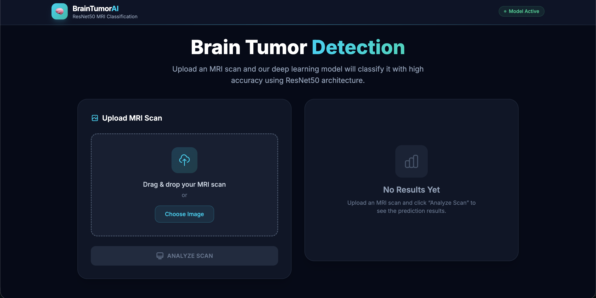
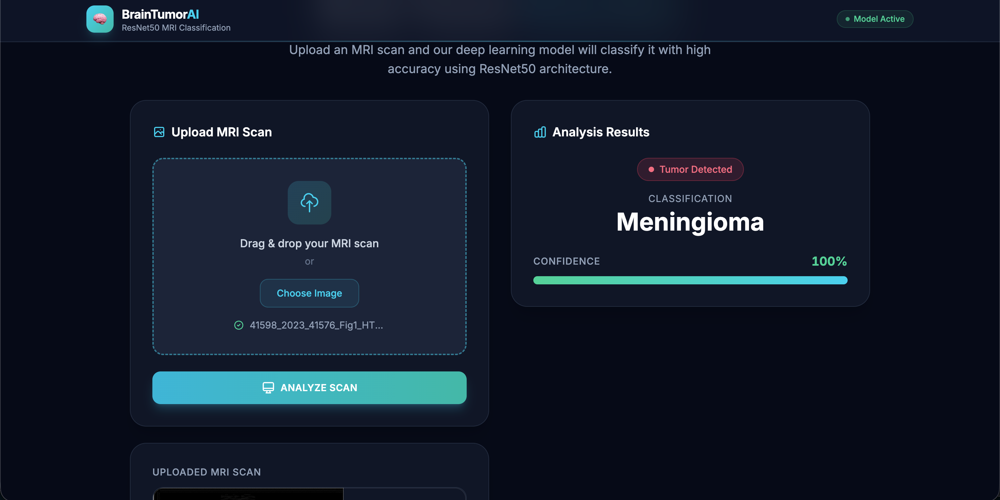
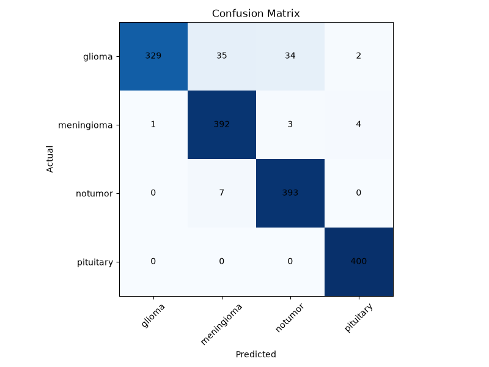

# 🧠 Brain Tumor Detection AI

# 📖 About

Brain Tumor Detection AI was developed as an end-to-end Computer Vision project to demonstrate:

- Deep Learning with Transfer Learning
- Medical Image Classification
- FastAPI REST API Development
- React Frontend Integration
- Model Evaluation and Performance Analysis

The model classifies MRI scans into the following categories:

- 🧠 Glioma
- 🧠 Meningioma
- 🧠 Pituitary Tumor
- 🧠 No Tumor

---

# ✨ Features

- 🧠 Brain MRI Classification
- 🔥 ResNet50 Transfer Learning
- ⚡ FastAPI REST API
- 🎨 React + Tailwind CSS Frontend
- 📤 Drag & Drop MRI Upload
- 🖼 MRI Image Preview
- 📈 Confidence Score Prediction
- ⏳ Loading Animation
- 📱 Responsive User Interface
- 📊 Confusion Matrix Evaluation
- 🔍 Grad-CAM Explainability (Model Evaluation)

---

# 📸 Screenshots

> Add your screenshots inside a **screenshots/** folder.

## 🏠 Home Page



---

## 📤 Upload MRI


---

## 📊 Prediction Result



---

## 📈 Confusion Matrix



---

# 🏗 System Architecture

```text
                 MRI Image
                     │
                     ▼
          React Frontend (Vite)
                     │
          HTTP POST (/predict)
                     │
                     ▼
             FastAPI Backend
                     │
                     ▼
        PyTorch ResNet50 Model
                     │
                     ▼
      Prediction + Confidence Score
                     │
                     ▼
          Display Prediction Result
```

---

# ⚙ Tech Stack

## Frontend

- React
- Vite
- Tailwind CSS

## Backend

- FastAPI
- Uvicorn

## Deep Learning

- PyTorch
- Torchvision
- ResNet50

## Image Processing

- Pillow
- OpenCV
- NumPy

## Visualization

- Matplotlib
- Grad-CAM

---

# 📂 Project Structure

```text
BrainTumorAI
│
├── backend/
│   ├── app.py
│   ├── model.py
│   └── predictor.py
│
├── frontend/
│
├── src/
│   ├── data/
│   ├── inference/
│   └── training/
│
├── reports/
│   ├── confusion_matrix.png
│   ├── sample_images.png
│   └── No Tumor_gradcam.png
│
├── saved_models/
│   └── best_model.pth
│
├── requirements.txt
├── README.md
└── .gitignore
```

---

# 🧠 Model Details

| Property | Value |
|----------|-------|
| Model | ResNet50 |
| Framework | PyTorch |
| Input Size | 224 × 224 RGB |
| Classes | 4 |
| Transfer Learning | Yes |
| Optimizer | Adam |
| Loss Function | CrossEntropyLoss |
| Epochs | 10 |

---

# 📊 Model Performance

| Metric | Value |
|---------|------:|
| Test Accuracy | **95%** |
| Precision | **95%** |
| Recall | **95%** |
| F1-Score | **95%** |

---

## Per-Class Performance

| Class | Precision | Recall | F1-Score |
|------|----------:|-------:|---------:|
| Glioma | 1.00 | 0.82 | 0.90 |
| Meningioma | 0.90 | 0.98 | 0.94 |
| No Tumor | 0.91 | 0.98 | 0.95 |
| Pituitary | 0.99 | 1.00 | 0.99 |

---

## Confusion Matrix


---

# 📁 Dataset

This project uses the **Brain Tumor MRI Dataset**.

**Dataset Source:**

https://www.kaggle.com/datasets/masoudnickparvar/brain-tumor-mri-dataset

After downloading, place the dataset in the following structure:

```text
dataset/
├── Training/
└── Testing/
```

> **Note:** The dataset is not included in this repository due to its size.

---

# 🚀 Installation

## Clone Repository

```bash
git clone https://github.com/manyachapra/BrainTumorAI.git

cd BrainTumorAI
```

---

## Create Virtual Environment

```bash
python -m venv venv
```

### Windows

```bash
venv\Scripts\activate
```

### macOS / Linux

```bash
source venv/bin/activate
```

---

## Install Python Dependencies

```bash
pip install -r requirements.txt
```

---

## Install Frontend Dependencies

```bash
cd frontend

npm install
```

---

# ▶ Run the Backend

```bash
cd backend

uvicorn app:app --reload
```

Backend URL

```text
http://127.0.0.1:8000
```

Swagger API

```text
http://127.0.0.1:8000/docs
```

---

# ▶ Run the Frontend

```bash
cd frontend

npm run dev
```

Frontend URL

```text
http://localhost:5173
```

---

# 📡 API

## POST `/predict`

Upload an MRI image using **multipart/form-data**.

### Request

```text
file : MRI Image
```

### Response

```json
{
  "prediction": "No Tumor",
  "confidence": 96.14
}
```

---

# 🚀 Future Improvements

- Deploy using Vercel (Frontend) and Render (Backend)
- Support DICOM medical images
- Improve Glioma classification using additional data
- Experiment with EfficientNet and Vision Transformers
- Integrate Grad-CAM visualization into the web application

---


## ⭐ If you found this project useful, please consider giving it a star!